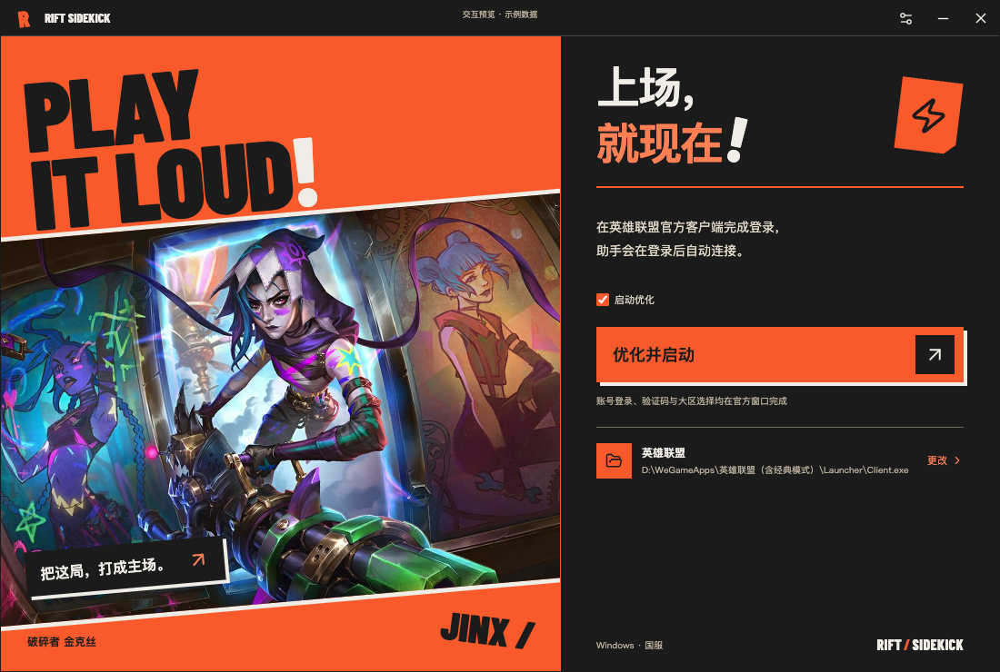
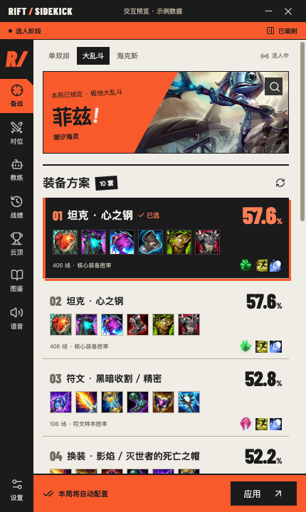
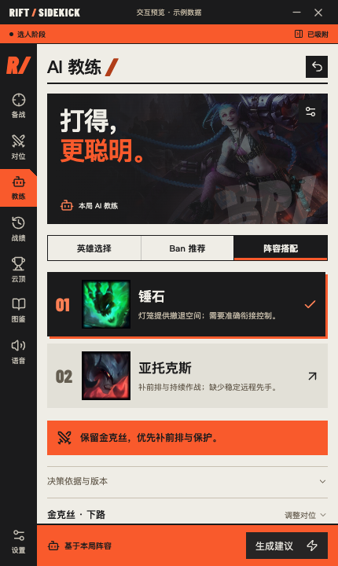
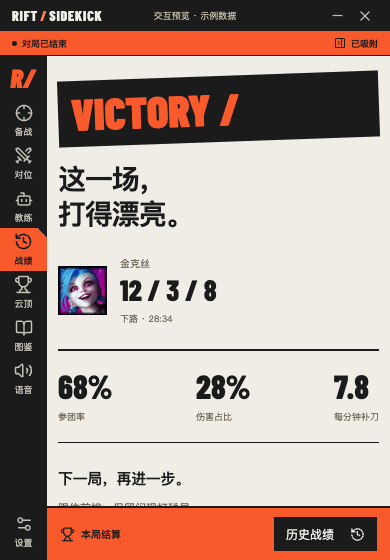

# Rift Sidekick · 开局整点花活

**选人少纠结，开局少折腾，打完还有一张属于你的冠军画报。**

给《英雄联盟》召唤师准备的 Windows 侧边助手：选人时帮你找出装、配符文、看对位，让 AI 教练参谋 BP；对局中有开黑搭子式的语音，结束后再看看这一把打得怎么样。

[下载 Windows 正式版](https://github.com/wuzhenghua-xijiang/rift-sidekick/releases/latest) · [看看新版变化](docs/releases/v0.2.8.md) · [反馈问题 / 提建议](https://github.com/wuzhenghua-xijiang/rift-sidekick/issues)

**当前版本：0.2.8 · Windows 10 / 11 x64 · 基础功能无需 AI Key**

本版新增战绩筛选、十人详情与时间线、大乱斗平衡与海克斯资料、教练英雄池及推荐离线缓存；AI 教练采用短结论、短理由，长内容可展开。[新增功能与验证范围 →](docs/HISTORY-ARAM.md)

> 独立玩家项目，非 Riot Games、腾讯或 WeGame 官方产品，未宣称获得其授权、认可或安全认证。使用前请阅读文末的[使用边界与声明](#使用边界与声明)。



## 这把，带个搭子

### 选完英雄，配置就跟上

自动跟随本局英雄、分路与模式，提供**最多 10 套去重的符文与出装方案**，有来源样本时保留坦克、输出等不同路线。锁定英雄后自动配置，喜欢哪套也可以手动切换并记住偏好；需要时可撤回最近一次配置。

- **召唤师峡谷、普通大乱斗**：同步符文、召唤师技能和商店装备套装。
- **海克斯大乱斗**：只同步装备，当前使用明确标注的普通大乱斗装备参考，不套用其胜率。
- **游戏里找装备**：按 **P → 物品套装 → `Rift · 英雄 · 方案`**。它不替换游戏原生的“推荐”标签。

### 选人室里，多一个 AI 教练

选谁更合适、Ban 谁更有价值、队友还缺什么？教练结合已公开阵容、分路和可用版本资料，给出**首选、备选与选择代价**，也会推荐具体的补位英雄。

双方全部锁定后，让它预测我方 / 敌方的阵容胜率，讲清关键原因，再来一句懂游戏的轻吐槽。这里的胜率会标明**“仅按阵容估计”**，不代表真实玩家实力或经过验证的统计预测，也不承诺胜负。

AI 教练需要自行配置 OpenAI 或兼容接口的 Base URL、模型和 API Key；服务商可能收费。基础出装、战绩等功能不需要这份配置。[教练使用说明 →](docs/AI-COACH.md)

### 对线有参考，对局有气氛

| 想做什么 | 助手能帮你什么 |
| --- | --- |
| 这英雄怎么对线？ | 查看对位小抄、技能与连招参考；有数据时展示对阵胜率和样本，对手不明确可手动修正。 |
| 这位置最近玩什么？ | 看分路热门榜，查英雄、称号与常用外号，点开就能研究方案。 |
| 打出高光，想有人接个梗 | 本地战斗语音支持击杀、配合、残血险胜、多杀与团灭；连续阵亡也有轻调侃。可关、可静音、可改台词，还有可选 AI 模式。 |
| 打完想看看自己的表现 | 看 KDA、伤害、参团等本局数据和冠军画报，翻自己的战绩，按客户端资格手动给队友点赞。 |
| 偶尔下下棋 | 看当季云顶阵容、站位、核心装备，复制阵容代码。 |

助手在选人时贴着客户端，进入游戏后自动隐藏，赛后再回来。默认战斗台词内置情绪音频，夸夸和调侃都跟随所选人设，包含台湾腔软嗲女声，离线即可播放；自定义和 AI 新台词使用 Windows 本机中文语音引擎，没有合适的中文声音时需要先安装。[语音功能说明 →](docs/COMBAT-VOICE.md)

## 看看实际界面

纸白、墨黑和燃橙的小窗，把信息留在需要的时候。

<table>
  <tr>
    <td align="center"><strong>备战 · 多套出装与符文</strong></td>
    <td align="center"><strong>教练 · 选人、Ban 与阵容</strong></td>
    <td align="center"><strong>赛后 · 冠军画报</strong></td>
  </tr>
  <tr>
    <td valign="top"></td>
    <td valign="top"></td>
    <td valign="top"></td>
  </tr>
</table>

以上是当前正式组件的界面预览，截图已标注示例数据；部分客户端状态、阵容和战报来自模拟验收场景，不代表真实账号、实战收益或当前版本推荐。实际内容随客户端、数据源和 AI 回复变化。备战图中的推荐来自当时的数据快照，不能把图中胜率当成本局获胜概率。

## 三步上场

1. **下载安装。** 到 [GitHub Releases](https://github.com/wuzhenghua-xijiang/rift-sidekick/releases/latest) 下载 `Rift-Sidekick-Setup-0.2.8-x64.exe` 并安装。请从本仓库发布页获取，核对随包的 `SHA256SUMS.txt`；当前安装包尚无 Windows 发布者代码签名，勿为安装而关闭安全防护。
2. **打开官方客户端。** 启动助手，确认游戏路径，点击启动；账号登录、验证与大区选择在英雄联盟官方窗口完成。你在官方客户端登录后，助手自动连接，不需要向助手提供 QQ 密码。
3. **选个英雄。** 进入选人后查看方案，锁定后检查是否显示“已应用”；想换就点另一套。要用 AI，再去 **设置 → OpenAI** 填写连接信息，回到教练页生成建议。

已有安装版可在 **设置 → 游戏 → 应用内更新** 检查新版。对局中先专心打，回到大厅再更新。

<details>
<summary><strong>第一次用，先看这几条</strong></summary>

- **没有分路？** 人机等模式会参考已保存偏好或英雄常用分路；不符合你的玩法时手动改选。常用分路不等于客户端实际分配的位置。
- **装备没有出现在“推荐”里？** 请到游戏商店的“物品套装”查找 Rift 方案；只在助手显示读回确认的“已应用”后视为配置成功。
- **想找回助手？** Windows 托盘可显示窗口；右上角关闭通常隐藏到托盘，彻底退出请用托盘菜单。
- **语音太热情？** 到语音设置调低音量或关闭。初次试听建议先调低音量。
- **推荐加载失败？** 数据、图片与 AI 均依赖各自服务；查看错误并稍后重试，不要把缺失数据当成零胜率。
- **小地图计时是什么？** 助手尝试开启游戏已有的高级营地计时，不提供额外隐藏视野或自行推算所有营地。接口不支持时按游戏内说明手动设置。[计时说明 →](docs/JUNGLE-TIMERS.md)

</details>

## 先把期待说清楚

- 当前面向 Windows 10 / 11 x64，主要围绕国服官方客户端使用；不提供 macOS / Linux 安装版。客户端更新、地区差异和接口限制可能导致部分功能不可用。
- 常规推荐主要使用 OP.GG 全球样本，**不是国服专属统计**。核心装备、符文和对阵胜率各有统计口径，不代表完整六件套、你的个人胜率或保证上分。
- AI 可能理解错误、遗漏版本改动或给出不合适的建议。提示词要求先识别版本、再使用匹配资料，但模型仍可能判断失误；请结合自己的英雄熟练度判断，别把教练估计当比赛结果。
- 发布包已经过自动检查和 Windows 构建；这些检查不能替代每个区服、设备和真实对局的验收。[已验证范围与待测项目 →](docs/WINDOWS-ACCEPTANCE.md)

## 数据与隐私

游戏登录在官方客户端完成。助手使用本机客户端接口提供的状态与数据；LCU 连接凭证仅用于本机连接，不发送给推荐服务或更新镜像。

推荐、图片和更新需要访问对应网络服务。**启用 AI 后，分析所需的阵容、版本资料或战斗事件等上下文会发送到你配置的服务商**，并受其条款、隐私政策和计费规则约束；个人推荐会包含匿名英雄池、熟练度与近期同模式汇总，不含昵称、PUUID 或账号编号。不想发送这些内容时，不启用 AI 功能。API Key 在本机通过系统加密保存，并用于向你配置的接口认证；不要在 Issue、日志或截图中公开密钥。

设置、缓存与恢复快照保存在 Windows 的 `%APPDATA%/rift-sidekick/`。提交问题时，请先遮盖账号标识、聊天内容、令牌、密钥等个人或敏感信息。

## 使用边界与声明

### 非官方身份与知识产权

Rift Sidekick 是独立社区项目，不隶属 Riot Games、腾讯、WeGame 或 OP.GG，也不宣称与其存在官方合作或赞助关系。本项目并未获得 Riot Games 背书，不代表 Riot Games 或参与制作、运营《英雄联盟》的相关人员的观点或意见。

《英雄联盟》《云顶之弈》的名称、英雄形象、原画、图标及相关商标归各自权利人所有。游戏素材用于说明项目功能与展示游戏相关内容，不表示项目拥有这些素材，也不向使用者转授其商业使用权。第三方代码与资源说明见 [THIRD-PARTY-NOTICES.txt](THIRD-PARTY-NOTICES.txt)；仓库公开不等于所有内容均可任意转载、再分发或商用。

如你是权利人并认为具体内容侵害权益，请通过 [Issue](https://github.com/wuzhenghua-xijiang/rift-sidekick/issues) 提供相关位置、权利依据与处理诉求，维护者将核实并酌情移除、替换或调整；请勿在公开反馈中提交身份证件等敏感材料。

### 公平竞技与账号风险

本项目定位是信息参考与客户端配置辅助：不提供自动战斗、走位施法、进程注入、读取游戏内存、绕过反作弊、获取隐藏敌方信息或匿名队友侦查，也不替玩家自动接受对局、选人或 Ban 英雄。

**使用本机接口、不读游戏内存，并不等于已获官方允许，也不能保证“零封号风险”。** 是否允许某项第三方功能，以游戏运营方当前规则及判断为准；请遵守你所在地区的用户协议、第三方应用政策与赛事规则。遇到官方限制、警告或不允许使用的场景，应停止相关功能，不尝试绕过。

相关规则请查阅 [Riot 第三方应用说明](https://support.riotgames.com/en-us/riot/events/third-party-applications)、[Riot 开发者政策](https://developer.riotgames.com/policies/general)、[Riot 粉丝项目政策](https://www.riotgames.com/en/legal)及[腾讯游戏许可及服务协议](https://game.qq.com/contract.shtml)。使用 League Client API 的产品还需遵守适用的注册与审核要求；Riot 的政策不等于腾讯国服授权。列出这些链接不表示本项目已通过相关审核或取得许可，公开分发及后续功能仍应单独核实其适用要求。

### 功能与责任边界

项目按现状提供，受开发维护、客户端及第三方服务变化影响。在适用法律允许的范围内，不承诺持续可用、数据或 AI 结论完全准确、一定兼容、提升帧率、提高胜率或避免账号处罚。请在了解自动配置、设置调整、AI 外发数据和第三方服务费用后自行决定是否启用，并保留重要配置。

本说明不构成法律意见，不替代必要授权或合规审查，也不排除适用法律规定不得排除的权利、义务或责任；一句“免责声明”不能使未获允许的行为自动获得许可。

## 反馈与参与

遇到问题请在 [Issues](https://github.com/wuzhenghua-xijiang/rift-sidekick/issues) 留下助手版本、Windows 版本、游戏模式、复现步骤和脱敏截图。你想要的下一项功能，也欢迎直接提。

[发布记录](https://github.com/wuzhenghua-xijiang/rift-sidekick/releases) · [AI 教练](docs/AI-COACH.md) · [战斗语音](docs/COMBAT-VOICE.md) · [启动说明](docs/GAME-LAUNCH.md)

<details>
<summary><strong>开发者：本地运行与打包</strong></summary>

使用 Node.js 24，依赖以 `package-lock.json` 为准。

```bash
npm ci
npm run dev
```

```bash
npm run typecheck
npm test
npm run dist:win
```

Windows x64 安装包输出到 `release/`。界面、数据和实际能力边界请结合 [设计基准](DESIGN.md)、[功能实现记录](docs/IMPLEMENTATION.md)与[验收清单](docs/WINDOWS-ACCEPTANCE.md)阅读。

</details>
