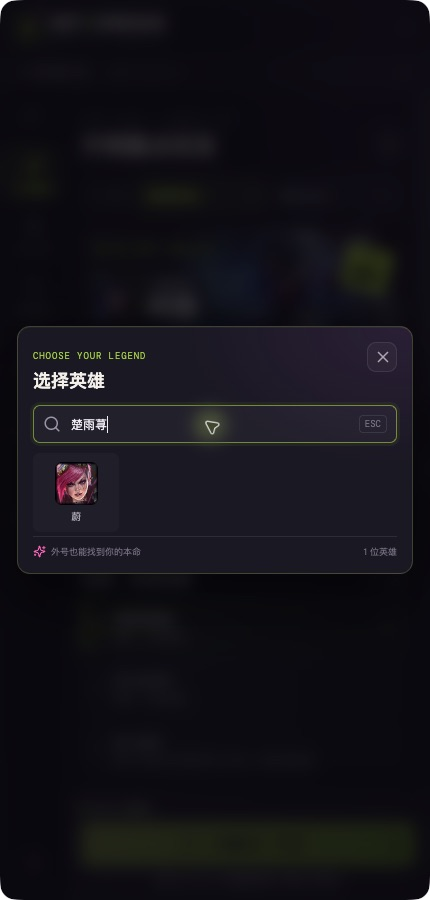

# 英雄搜索词库

0.1.1 增加内置外号、拼音和缩写搜索。关键词随应用打包，搜索时不请求网络；英雄展示仍使用当前资源目录中的名称、称号与头像。

基础词库来自[腾讯英雄资料与搜索关键词](https://game.gtimg.cn/images/lol/act/img/js/heroList/hero_list.js)：资源版本 16.21，源文件更新时间 2026-10-21，共 173 位英雄、1,577 个去除空项和完全重复项后的搜索词。提取的字段仅包括数字英雄 ID、中文名称、称号、英文 ID 与 `keywords`，保存在 `src/shared/champion-keywords.ts`。

在 `src/shared/champion-search.ts` 中补充常见社区叫法、旧名称和译名。示例：

| 搜索词 | 对应英雄 |
| --- | --- |
| 炸弹人、zhadanren、ZDR | 吉格斯 |
| 楚雨荨、chuyuxun、cyx | 蔚 |
| 人马、renma | 赫卡里姆 |
| 狗头、石头人、挖掘机 | 内瑟斯、墨菲特、雷克塞 |
| 小火龙、画家、铁女 | 斯莫德、彗、芮尔 |
| 快乐风男、托儿索 | 亚索 |
| 男枪、女枪、刀妹 | 格雷福斯、厄运小姐、艾瑞莉娅 |

搜索以数字英雄 ID 关联词库，避免翻译变化及 `FiddleSticks`/`Fiddlesticks` 等英文大小写差异造成失配。保留当前目录的名称、称号和英文 ID 搜索；未来新英雄即使尚无外号也能按正式资料查找。

忽略大小写、全角字母、空格和标点，因此 `Lee Sin`、`Kha’Zix`、`ＫＡＩ’ＳＡ` 都可匹配。逐词匹配，防止把相邻关键词拼成不存在的外号。正式名称完整匹配优先，其次为外号完整匹配、前缀匹配和包含匹配；同一外号对应多个英雄时保留全部结果。例如“波比”首先显示波比，其后仍可找到“熬夜波比”薇古丝。

## 检索来源

- [腾讯英雄资料](https://game.gtimg.cn/images/lol/act/img/js/heroList/hero_list.js)：基础词库、常见外号及拼音缩写。
- [GitHub 英雄别名 CSV](https://gist.github.com/dcalsky/64d510479619b880b07569e85f370198)：通过 `gh api` 核对常见旧称与外号；只选取明确的英雄别称，未将整份历史表覆盖现行英雄名称。
- [游侠：楚雨荨是什么梗](https://m.ali213.net/news/gl2403/1348955.html)：确认“楚雨荨”对应蔚。
- [芮尔外号讨论](https://www.sohu.com/a/433987059_120237550)：铁女、马妹。
- [特玩：斯莫德相关报道](https://lol.te5.com/2024/1245796.html)：小火龙。
- [彗英雄语音预览](https://www.bilibili.com/video/BV1La4y1o7oP/)：小画家。
- [游民星空：永岚改名芸阿娜](https://www.gamersky.com/news/202506/1949973.shtml)：兼容旧译名。

更新基础词库时按上述字段重新提取并核对英雄数字 ID；社区词条单独维护，避免被新快照覆盖。搜索专项测试覆盖用户指定的三个外号、常见外号、拼音缩写、标点/全角输入、排序、歧义和未来英雄。

0.1.1 已通过类型检查和 25 项搜索专项测试，并在实际应用窗口中验证“炸弹人”“楚雨荨”“人马”均显示对应英雄。窗口检查在 macOS 上运行相同的 Electron 界面完成，Windows 安装包已构建，尚未在 Windows 真机安装验收。

